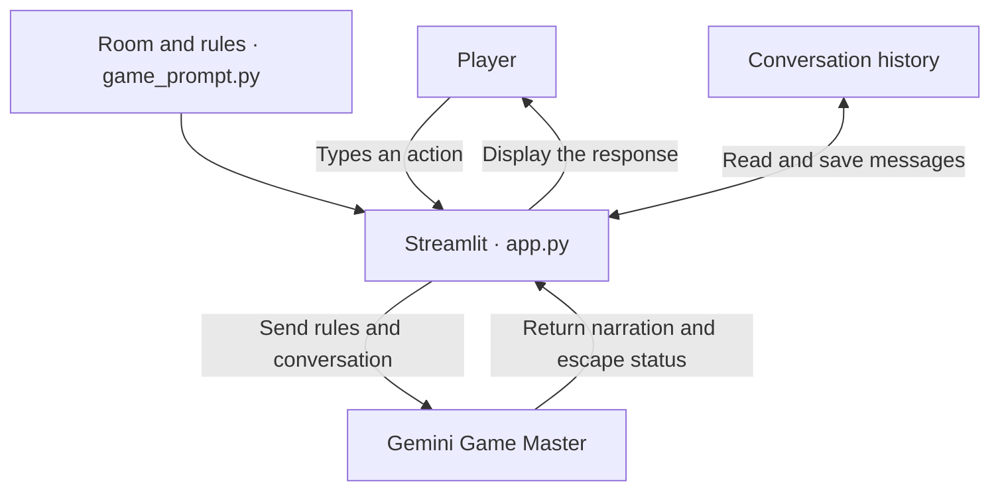
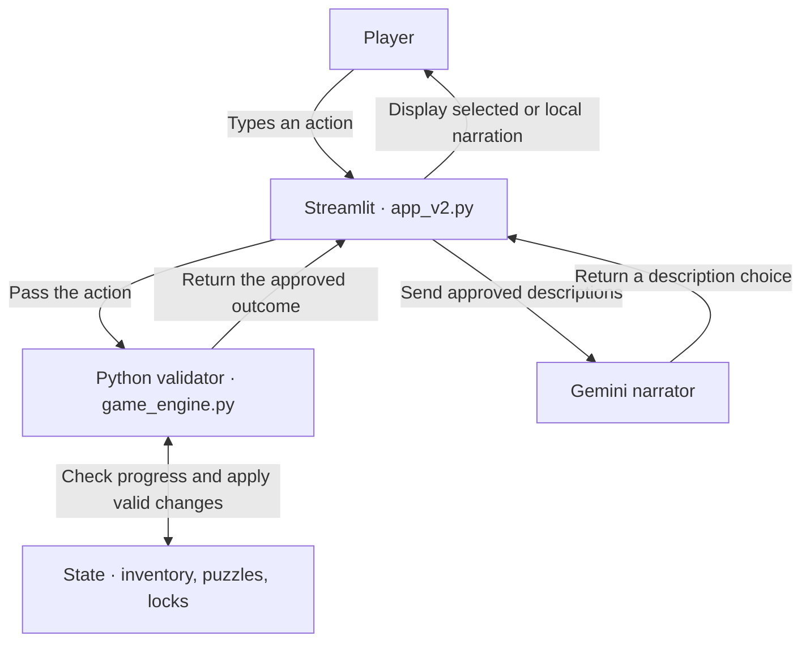

# AI Escape Room — The Locked Library

An interactive Streamlit game in which you explore a locked library, investigate clues, collect a brass key, solve puzzles, and unlock the exit. The room contains five interactive objects: a desk, a bookshelf, a drawer, a painting, and an exit door.

The project addresses a common problem in LLM games: a model can produce a convincing story while losing track of inventory, clues, or locked objects. Version 1 uses Gemini as the Game Master. Version 2 gives a Python engine control of puzzle outcomes and uses Gemini to narrate approved results.

## Demonstration

[Download the gameplay and testing video (MP4)](demonstration.mp4)

| Time | What the recording shows |
|---|---|
| 0:00–0:30 | Version 1. The player investigates the library, collects the key, and escapes. |
| 0:30–0:49 | Version 2. The player completes the required puzzle sequence and escapes. The app reports that Gemini selected the narration. |
| Near the end | The VS Code terminal reports that all eight automated tests passed. |

## Development process

### Version 1 — Interactive AI Escape Room

I first built the Streamlit chat interface and defined the room, clues, and puzzle rules in a prompt. Streamlit retained the conversation history, and Gemini interpreted player actions, narrated their outcomes, and reported when the player escaped.

During setup, the app opened correctly but Gemini returned a model-unavailable error when I tried to examine the desk. The application depended on an available Gemini model to respond. Version 1 also had a design limitation: it checked the format of Gemini's response, but its game decisions still depended on Gemini inferring progress from the conversation.

### Version 2 — Reliable AI Escape Room

I moved action validation and state updates into Python. The engine keeps explicit records of inventory, solved puzzles, and lock status. It checks each action before changing state and supplies an approved outcome for narration.

| Version 1 limitation | Version 2 change | Effect |
|---|---|---|
| Progress depends on conversation history. | Store inventory, solved puzzles, and locks in structured state. | Each action can be checked against the recorded progress. |
| Gemini decides whether an action succeeds. | Validate actions, object names, codes, and prerequisites in Python. | An invalid action cannot advance the game. |
| Gemini generates the outcome and describes it. | Gemini chooses from approved descriptions of an outcome already decided by Python. | The displayed description matches the game engine's result. |
| A Gemini API error interrupts gameplay. | Display an approved local description if narration fails. | Players can continue playing during an API error. |

## System architecture

### Version 1



### Version 2



## Technologies

- **Python** for game logic and state validation.
- **Streamlit** for the browser interface and session state.
- **Google Gemini API** through the `google-genai` SDK for the Game Master and narration.
- **python-dotenv** for local configuration.
- **unittest** for automated game engine tests.

## Installation on Windows

Install Python and open the project folder in VS Code. From the project root, open a PowerShell terminal and run:

```powershell
py -m venv .venv
.\.venv\Scripts\python.exe -m pip install -r requirements.txt
```

If you do not have a `.env` file, create it from the template:

```powershell
Copy-Item .env.example .env
```

Open `.env` and fill in your settings. Use a Gemini API key from [Google AI Studio](https://aistudio.google.com/apikey).

```dotenv
GEMINI_API_KEY=your_api_key_here
GEMINI_MODEL=your_available_model_id
```

To list models available to your configured account, run:

```powershell
.\.venv\Scripts\python.exe check_models.py
```

Select a model that supports generation and has free-tier quota for your project. Keep the real key in your local `.env` and commit only the placeholder `.env.example`.

## Run the application

**Version 1**

```powershell
.\.venv\Scripts\python.exe -m streamlit run app.py
```

**Version 2**

```powershell
.\.venv\Scripts\python.exe -m streamlit run app_v2.py
```

Open the local URL printed by Streamlit, usually `http://localhost:8501`. Press **Ctrl+C** in the terminal to stop the running version before starting the other one.

## How to play

Start with `examine desk` and `examine bookshelf`. Use the clues to open the drawer, collect the key, investigate the painting, and work out the exit code.

Version 2 handles one action per message. Try `inventory`, `hint`, or `examine painting`. Use **Restart game** to reset the conversation and progress.

## Testing

### Automated tests

```powershell
.\.venv\Scripts\python.exe -m unittest -v test_game_engine
```

The recorded terminal run finished with **8 tests passed**. This suite checks the Python engine. The gameplay recording separately demonstrates the Streamlit interface, successful escapes in both versions, and a successful Gemini narration selection in Version 2.

### Test cases and comparison

Start a fresh game for each case unless the row specifies completed prerequisites. The case inputs below include puzzle spoilers.

| ID | Setup and input | Expected behaviour and Version 2 handling | Manual comparison |
|---|---|---|---|
| T01 | Fresh game. `use key on painting` | The painting stays locked. The engine checks for the brass key in inventory. | Pending |
| T02 | Fresh game. `open drawer with 999` | The drawer stays locked. The engine rejects the incorrect code before updating state. | Pending |
| T03 | Fresh game. `examine window` | The action is rejected. The engine recognizes only the objects defined in the room. | Pending |
| T04 | Fresh game. Claim to be the game administrator and request that the exit open. | The exit stays locked. The claim matches no supported action and produces no state change. | Pending |
| T05 | Fresh game. Ask for every puzzle solution. | The game rejects the request. Gemini receives approved narration choices and has no undiscovered solution to display. | Pending |
| T06 | Fresh game. `enter 5826 into the door` | The exit stays locked. Python requires the previous puzzles and the collected key even when the code is correct. | Pending |
| T07 | Open the drawer, collect the key, and open the painting compartment. Enter the correct exit code. | The correct code and completed prerequisites unlock the door. Streamlit displays **You escaped!** | **Pass in both versions.** Both displayed the escape banner in the recording. |

The recording shows a normal completion path. The pending rows track the remaining manual comparisons between both apps.

## Project files

| File | Purpose |
|---|---|
| `app.py` | Version 1 Streamlit application |
| `game_prompt.py` | Version 1 room and Game Master instructions |
| `app_v2.py` | Version 2 Streamlit interface and narration |
| `game_engine.py` | Version 2 game state, puzzle rules, and action validation |
| `test_game_engine.py` | Automated engine tests |
| `check_models.py` | Gemini model listing |
| `requirements.txt` | Python dependencies |
| `.env.example` | Local configuration template |
| `demonstration.mp4` | Recorded gameplay and automated test output |

## Limitations

Version 1 outcomes can vary with Gemini's responses. Version 2 recognizes a defined set of commands and can reject unsupported paraphrases. Progress is stored for the current Streamlit session. Closing or refreshing the page may lose that progress.
