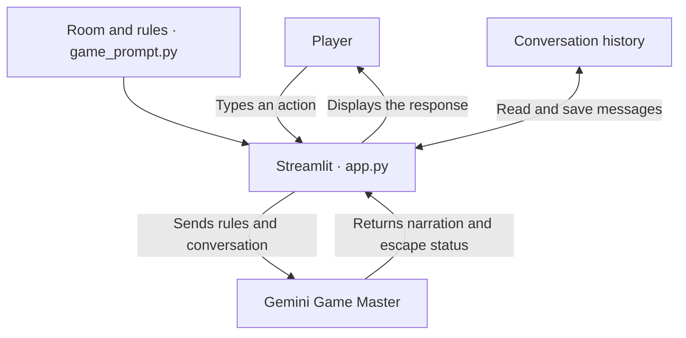
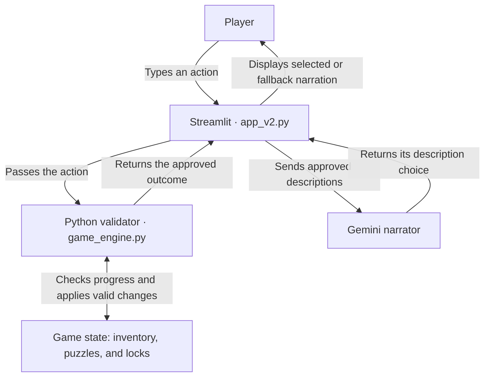

## System Architecture

### Version 1 — Interactive AI Escape Room

Gemini interprets the player's action, decides what happens, and narrates the result. Streamlit stores the conversation and displays the response.

### Version 2 — Reliable AI Escape Room

Python checks each action and updates the game state. Gemini selects an approved description of the outcome. If Gemini is unavailable, Streamlit displays the approved local description.